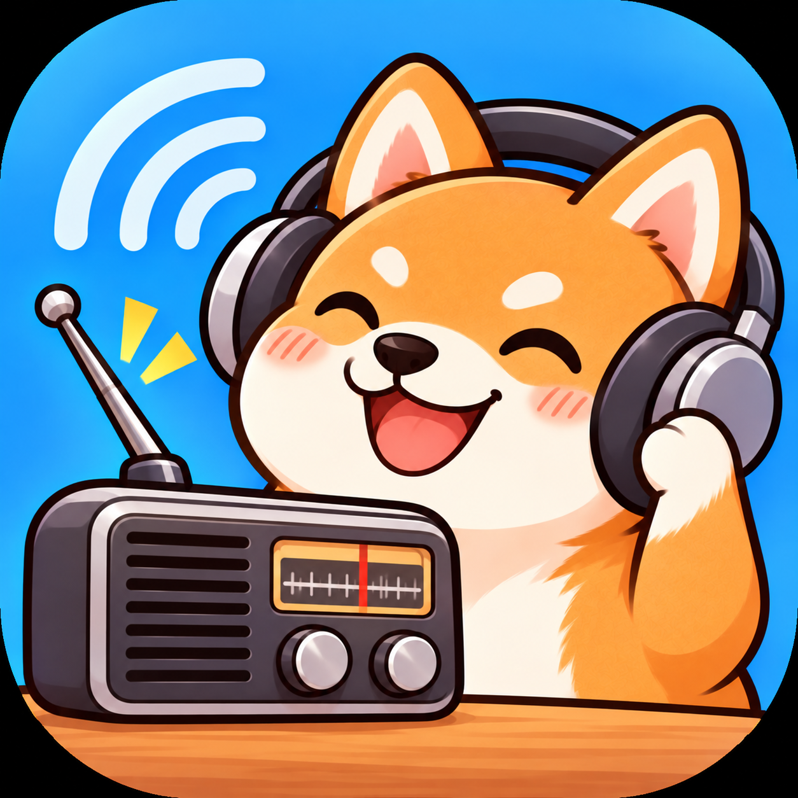
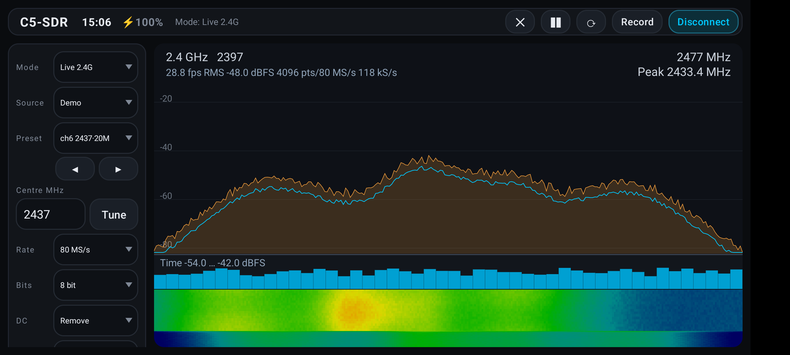
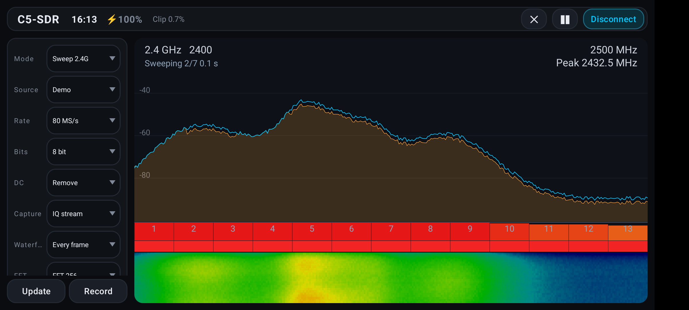
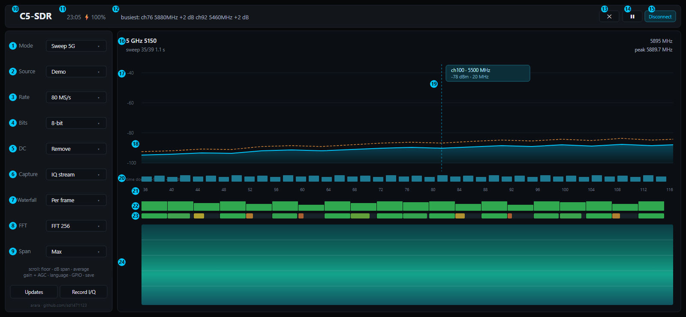

<p align="center">
  
</p>

# C5-SDR — Wi-Fi spectrum analyzer for ESP32-C5 on Android

**English** · [简体中文](README.zh-CN.md) · [](LICENSE)

A Wi-Fi spectrum analyzer in your pocket: plug an **ESP32-C5** board into an Android phone over
**USB OTG** and watch the **2.4 GHz and 5 GHz** bands live — spectrum, waterfall, per-channel
occupancy and I/Q recording. No extra SDR hardware, no root, no Python.

Under the hood it is the Android front-end for the ESP32-C5 Wi-Fi SDR firmware used by
[ESP32_C5_Wifi_spectrum_analyzer](https://github.com/sd1471123/ESP32_C5_Wifi_spectrum_analyzer):
it speaks the same line protocol as `espsdr.py` and draws everything natively with `Canvas` —
no Qt, no plotting library.

Author: **arara** · <https://github.com/sd1471123/>

## Screenshots

Real device screenshots (demo source — a synthetic Wi-Fi band, so they render the same
UI the board drives):

| Live 2.4 GHz | Full-band sweep, 2.4 GHz |
| --- | --- |
|  |  |

Left: live capture at ch6 — average trace (cyan), peak hold (orange), dB axis readout,
per-frame block-power strip and the scrolling waterfall.
Right: the 2.4 GHz sweep — per-20 MHz-channel activity strip (green → red), "busiest
channel" and "best detection" summaries in the top bar, waterfall stitching the passes.

中文界面截图见 [README.zh-CN.md](README.zh-CN.md)。`docs/ui-mockup.html` is still there
as a pixel-accurate layout mockup.

## Interface



The mock-up shows **sweep mode with the demo source**, where every panel is populated at once;
live mode simply drops rows 22–23. The left rail scrolls, so the numbers cover its top part only.

### Left rail

| # | Control | What it does |
| --- | --- | --- |
| 1 | Mode | `Live 2.4G` / `Live 5G` / `Sweep 2.4G` / `Sweep 5G`. Live streams a single centre frequency; sweep walks the band in 20 MHz steps and stitches the passes. |
| 2 | Source | `USB device` (real board) or `Demo` (synthesised band — the whole UI works without hardware). |
| 3 | Sample rate | 80 / 40 / 20 / 10 / 8 / 4 MS/s. Wider sees more at once but costs USB bandwidth. |
| 4 | Bit depth | 8 or 10-bit IQ. 10-bit buys dynamic range at half the bandwidth. |
| 5 | DC | Removes the DC spike before the FFT. Keep it on when the board leaks its LO. |
| 6 | Capture | `IQ stream` — raw samples, FFT on the phone, time-domain strip included; `On-chip spectrum` — the chip's own FFT, lighter over USB, no time domain. |
| 7 | Waterfall | Row rate: every frame / 2 / 4 frames. Slower rows make the waterfall easier to read. |
| 8 | FFT | 256 / 512 / 1024 / 2048 bins. More bins = finer frequency detail, slower refresh. |
| 9 | Bandwidth | Displayed span (max / 48 / 24 / 12 MHz). Zoom only — it does not change the capture. |

### Top bar

| # | Element | What it does |
| --- | --- | --- |
| 10 | Title | App name. |
| 11 | Clock · battery | Battery shows ⚡ while charging. |
| 12 | Status line | In sweep mode: `busiest: ch76 5880MHz +2 dB`. In live mode: frame rate, RMS and sample count. Frozen while paused. |
| 13 | Clear ✕ | Drops the peak-hold trace and the waterfall history. |
| 14 | Pause ❚❚ | Stops the capture loop itself — spectrum, waterfall and the status line all freeze; tapping again continues the sweep where it stopped. |
| 15 | Connect / Disconnect | Opens or releases the USB link to the board. |

### Chart panel

| # | Element | What it does |
| --- | --- | --- |
| 16 | Panel header | Band, centre frequency and sweep progress on the left; display ceiling and peak frequency on the right. |
| 17 | dB axis | Power scale, driven by the noise-floor and span settings. |
| 18 | Spectrum trace | Cyan = average, orange dashes = peak hold. |
| 19 | Marker readout | Tap the spectrum to drop a marker: channel, frequency, level and bandwidth at that point. |
| 20 | Time-domain strip | Block power per capture (dBFS) — good for spotting bursts and duty cycle. Live mode only. |
| 21 | Channel numbers | The 20 MHz channel in each slot, shared by rows 22 and 23. |
| 22 | Channel activity | How far each channel sits above the noise floor, 0–30 dB mapped to bar height, green → red. Refreshed every sweep. |
| 23 | Detection rate | Share of sweeps in which that channel was judged occupied (≥ 12 dB above the floor), averaged over the session. |
| 24 | Waterfall | Spectrum history over time, brighter = stronger. Drag the divider above it to change the split. |

Rows 22 and 23 answer different questions: 22 is *how strong right now*, 23 is *how consistently
occupied*. High 22 + high 23 = a steady AP; high 22 + low 23 = something intermittent; low 22 +
high 23 = a weak but constant signal from far away.

The Chinese version of this guide is in [README.zh-CN.md](README.zh-CN.md).
The picture itself is generated from [`docs/ui-guide-en.html`](docs/ui-guide-en.html) — edit that and
re-export the PNG with a headless browser.

## Related projects

| Part | Repository | What it is |
| --- | --- | --- |
| **Firmware** | [ESPARGOS/esp-sdr](https://github.com/ESPARGOS/esp-sdr) | ESP-SDR firmware that turns the ESP32 family into a low-duty-cycle SDR. **The ESP32-C5 board must be flashed with this before the app can talk to it.** |
| **Desktop host** | [sd1471123/ESP32_C5_Wifi_spectrum_analyzer](https://github.com/sd1471123/ESP32_C5_Wifi_spectrum_analyzer) | Python/Qt desktop client for the same firmware — the reference implementation of the protocol, band plans and DSP this app mirrors |
| **Android client** | this repository | Phone-side UI: USB-OTG capture, spectrum + waterfall, channel analysis, I/Q recording |

All three speak one line protocol (`espsdr.py` on the desktop side), so a board that already
works with the desktop app works here unchanged — same firmware, same commands, same numbers.

## Build

1. Android Studio (Ladybug or newer, JDK 17) → **File → Open** → select this directory.
2. Let Gradle sync (it creates `gradlew` for you if you want the wrapper committed).
3. Plug the phone in, **Run**.

There is no Gradle wrapper in the repository on purpose (the wrapper JAR is binary);
Android Studio's bundled Gradle works fine. From the command line, with a local Gradle 8.7+:

```
gradle :app:assembleDebug
```

### Release signing

`app/build.gradle.kts` signs the release build from `keystore.properties` (not in git):

```
storeFile=keystore/sdr-release.jks
storePassword=...
keyAlias=sdr
keyPassword=...
```

Without that file `assembleRelease` simply produces an unsigned APK.

### Launcher icon

All mipmap densities and the adaptive icon are generated from `icon.png`:

```
powershell -ExecutionPolicy Bypass -File tools/make_icons.ps1
```

## Hardware

- ESP32-C5 board flashed with the [ESP-SDR](https://github.com/ESPARGOS/esp-sdr) firmware.
  The desktop project's `flash_c5.py` is one convenient way to flash it; `idf.py flash` works too.
- Connect the board's **"USB" port (native USB Serial/JTAG)** to the phone with an OTG adapter.
- **Power**: the radio draws current spikes at start-up and a phone's OTG port often cannot
  supply them — the board may brown out and reboot. Use a powered OTG hub / Y-cable if the
  connection drops right after "connected".
- The UART port (CH343, VID `0x1A86`) works too: the app probes 2 MBaud / 1 MBaud when opening
  and automatically upgrades UART links to 2 MBaud when the firmware supports `UARTBAUD`
  (`TRANSPORT?`/`BAUD`). Native USB needs none of that and remains the recommended path.

## What works

| Feature | Status |
| --- | --- |
| Landscape two-pane UI (control rail + spectrum), dark card theme, centre-frequency / LO rows hidden while sweeping | ✅ |
| Device detection (VID `0x303A` / `0x1A86`), USB permission flow | ✅ |
| SYNC/resync handshake, `INFO` / `CAPS` / `LIMITS?` / `VERSION?` build date | ✅ |
| `CAP16` (8-bit) and `CAP20` (10-bit) captures with CRC32 verification | ✅ |
| UART bridges (CH343): 2 MBaud / 1 MBaud probing at open, `TRANSPORT?` negotiation, automatic upgrade to 2 MBaud, transport shown in the status bar | ✅ |
| Live spectrum: average + peak hold (Hann window, per-frame DC removal — toggleable —, fftshift) | ✅ |
| On-chip spectrum: the chip's own `SPEC` FFT stream, decoded to the same dBFS scale (0.5 dB/code, newest-frame-wins, CRC resync) | ✅ |
| Capture source picker: I/Q stream (phone-side FFT) / on-chip spectrum (live mode) | ✅ |
| Auto-scaled dB axis and a manual floor + span axis, both persisted | ✅ |
| Trace averaging (off / short / medium / high) and pause / clear | ✅ |
| Waterfall (scrolling bitmap, blue→red map) with a row-rate limit (every frame / 30 / 12 / 4 rows/s) and a draggable spectrum/waterfall split | ✅ |
| Center frequency input + tuning | ✅ |
| Gain slider (0–79) with an AGC (`GAIN HARDWARE`) switch | ✅ |
| Sample rate 80…4 MS/s, FFT 256…4096, analog bandwidth 11–48 MHz, LO offset, `LPF AUTO` / `ALPF AUTO` | ✅ |
| Band sweep: 2.4 GHz 7 steps / 5 GHz 39 steps, stitched with the ±10–20 MHz window | ✅ |
| Sweep display holds the previous pass in not-yet-scanned bins; peak hold persists (2 dB/sweep decay) | ✅ |
| Channel presets with the full centre frequency (`ch6 2437·20M`): every 20 MHz channel, plus the 40/80 MHz groupings used by 5 GHz APs | ✅ |
| ◀ ▶ buttons under the preset box step to the previous / next channel, wrapping at both ends | ✅ |
| Per-20 MHz-channel activity strip + "busiest channel" readout | ✅ |
| Detection rate per channel (% of finished sweeps with the channel peak >12 dB above the noise floor, matching the desktop app) | ✅ |
| Time-domain strip in live mode (block power per FFT frame) | ✅ |
| Clipping statistic (share of I/Q samples at full scale) with a warning | ✅ |
| Frame rate / RMS / sample throughput (kS/s) readout | ✅ |
| Level marker (tap), tune (double tap), drag to pan, pinch to zoom, edge-drag retune in live mode | ✅ |
| GPIO pin panel (`GPIO?` / `GPIO <pin> Z|0|1`) for boards that expose pins | ✅ |
| I/Q recording to a file picked with the system document picker (`.cfile`, signed 8-bit, ±127 = full scale) | ✅ |
| Demo source: a synthetic Wi-Fi band that drives the exact same UI, for desk testing without a board | ✅ |
| Chinese / English UI, defaulting to the system language (everything else falls back to English), switchable in the rail | ✅ |
| Immersive full screen (edge-to-edge, display cutout kept clear) with the clock + battery next to the title | ✅ |
| In-app self-update check against this repository's releases | ✅ |

## Not implemented yet

- `.npy` / `.json` metadata sidecars for recordings (only raw `.cfile` so far)
- Firmware flashing from the phone

Recording in **sweep mode** writes every step as it is captured, so the file is a sequence of
20 MHz slices rather than one continuous band — use live mode for a clean continuous capture.

## Protocol notes (why the code looks like this)

- **DTR must be asserted** (`SET_CONTROL_LINE_STATE`, bit 0) or the firmware never sends data.
- **RTS stays de-asserted** (bit 1 clear) so the board is not reset by the auto-reset circuit.
- A previous client that died mid-transfer leaves the device blocked on output, so `resync()`
  drains the port and retries `SYNC <nonce>` up to 8 times, exactly like `espsdr.py`.
- `CAP16 <n> <rate>` answers `DATA <n> <crc32> <us>` plus `n*2` bytes of signed 8-bit I/Q
  (I, Q interleaved), CRC32 = zlib compatible. `CAP20` packs two 10-bit words LSB-first into
  20 bits, so the payload is `n*20/8` bytes. Rate indices 0–5 are 80/40/20/10/8/4 MS/s.
- Samples are scaled by 1/128 (8-bit) or 1/512 (10-bit) to `[-1, 1)` full scale.
- `SPEC 0 1 1 <det> <rate> <n>` makes the chip stream its own FFT: `SPC1` frames with a
  28-byte header, `n` power codes (20log10(power), 1 dB per code) and a CRC32. The stream
  runs until an empty line; `SPECEND` is glued to the last frame with no newline. Codes map
  to the app's dBFS scale as `code/2 − 84.3` (full-scale sine = 0 dBFS), and the wire bins
  are in natural FFT order (bin 0 = DC), so the display applies the same fftshift as `Dsp`.
- `TRANSPORT?` answers `TRANSPORT UART <baud>` / `TRANSPORT USB 0`; `BAUD <rate>` retunes a
  UART bridge (the ack can get lost in the switch — reopen and re-verify).

## Layout

```
app/src/main/java/io/github/sd1471123/sdr/
  Espsdr.kt       USB CDC + line protocol client (CAP16/CAP20, SPEC stream, TRANSPORT?/BAUD, GPIO)
  Fft.kt          radix-2 FFT
  IqCodec.kt      8/10-bit I/Q unpacking (CAP20: 2 x 10 bits LSB-first per 20-bit word)
  Dsp.kt          capture -> average / peak-hold spectra, block power, clipping
  Bands.kt        band plans, channel + 20/40/80 MHz presets, Mode enum, SdrFrame
  SdrSource.kt    engine/source interface (capture mode, DC removal, capture-source flags)
  SdrEngine.kt    capture thread: live (I/Q or on-chip spectrum) + band sweep, channel stats
  DemoEngine.kt   synthetic source that drives the same UI without a board
  IqRecorder.kt   raw int8 I/Q writer (.cfile)
  SpectrumView.kt Canvas spectrum, time-domain strip, activity + detection bars, waterfall, marker/zoom
  Updater.kt      in-app release check
  MainActivity.kt USB permission, mode/parameter spinners, recording, language, GPIO panel, UI wiring
app/src/main/res/values-zh/strings.xml   Chinese UI strings (values/ is English)
tools/make_icons.ps1                     regenerates every launcher icon from icon.png
tools/esp_sdr_*.ps1                      board probes: CAP16/CAP20, SPEC stream, TRANSPORT?/BAUD
docs/ui-mockup.html                      pixel-accurate UI layout mockup
```

Build check: `gradle :app:assembleDebug` passes with AGP 8.5.2 / Kotlin 1.9.24 (SDK 34).

## License

GPL-3.0 — see [LICENSE](LICENSE).

Copyright (C) 2026 arara &lt;https://github.com/sd1471123/&gt;

This program is free software: you can redistribute it and/or modify it under the terms of the
GNU General Public License as published by the Free Software Foundation, either version 3 of the
License, or (at your option) any later version.

This program is distributed in the hope that it will be useful, but WITHOUT ANY WARRANTY; without
even the implied warranty of MERCHANTABILITY or FITNESS FOR A PARTICULAR PURPOSE. See the GNU
General Public License for more details.
