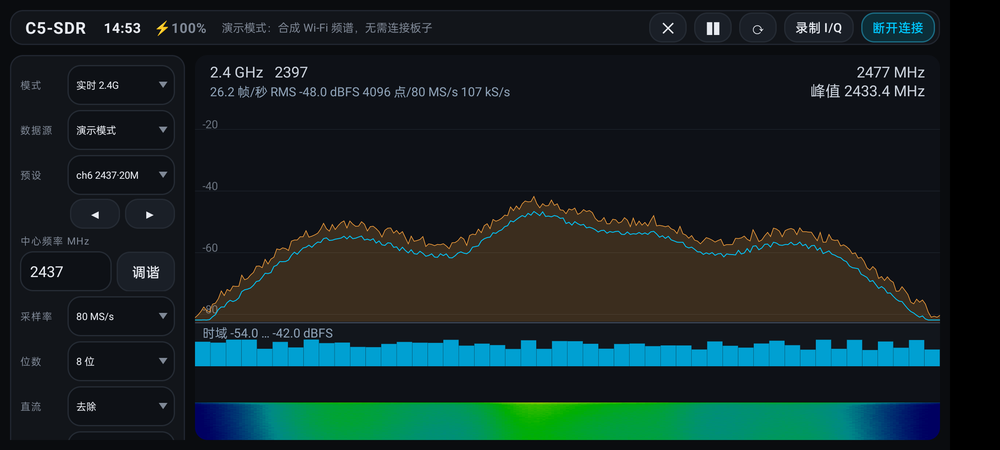
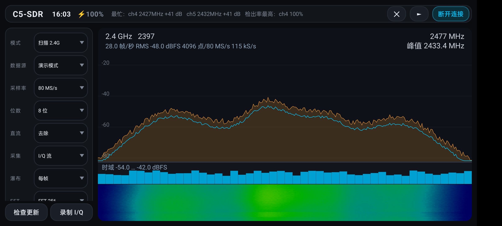
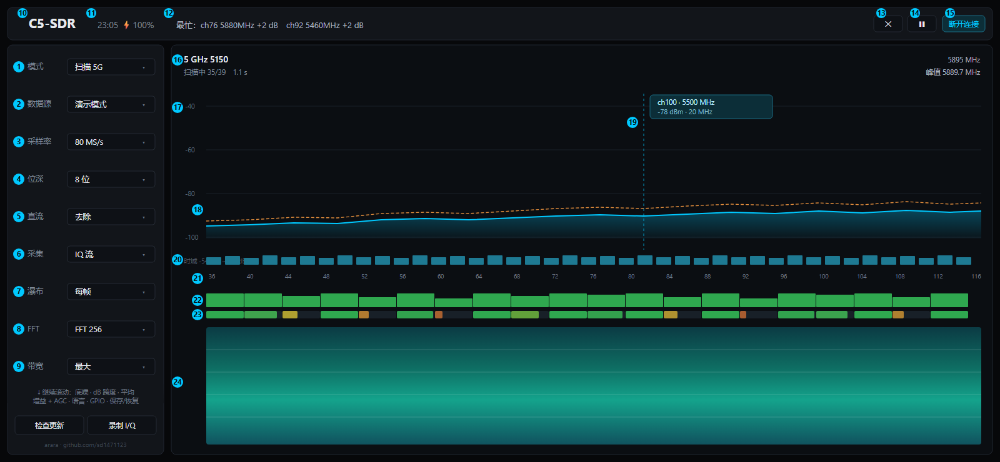

<p align="center">
  
</p>

# C5-SDR — ESP32-C5 Wi-Fi 频谱分析仪（Android）

[English](README.md) · **简体中文** · [](LICENSE)

口袋里的 **Wi-Fi 频谱分析仪**：把 **ESP32-C5** 开发板通过 **USB OTG** 接到 Android 手机，
就能实时查看 **2.4 GHz 与 5 GHz** 频段——频谱图、瀑布图、逐信道占用度与 I/Q 录制。
不需要额外的 SDR 硬件，也不需要 root 或 Python。

底层上它是 [ESP32_C5_Wifi_spectrum_analyzer](https://github.com/sd1471123/ESP32_C5_Wifi_spectrum_analyzer)
所用 ESP32-C5 Wi-Fi SDR 固件的 Android 前端，与 `espsdr.py` 使用同一套行协议通信，
频谱图和瀑布图全部用 `Canvas` 原生绘制——不依赖 Qt 或任何绘图库。

作者：**arara** · <https://github.com/sd1471123/>

## 界面预览

以下为真机截图（数据源为演示模式——合成的 Wi-Fi 频段，渲染出的界面与板子驱动时完全一致）：

| 实时 2.4 GHz | 2.4 GHz 全频段扫描 |
| --- | --- |
|  |  |

左图：ch6 实时采集——平均谱（青色）、峰值保持（橙色）、dB 轴读数、逐帧块功率条与滚动瀑布图。
右图：2.4 GHz 扫描——每 20 MHz 信道占用度条（绿→红）、顶栏"最忙信道 / 检出率最高"摘要、多轮拼接的瀑布图。

英文界面截图见 [README.md](README.md)。

## 界面说明



英文界面说明见 [README.md](README.md#interface)（示意图为 [`docs/ui-guide-en.png`](docs/ui-guide-en.png)）。
示意图源码是 [`docs/ui-guide.html`](docs/ui-guide.html)，改完用无头浏览器重新导出 PNG 即可。

示意图绘制的是**扫描模式 + 演示数据**，此时所有面板都有内容；实时模式只是少了 22、23 两行。
左侧栏可滚动，编号只覆盖它的上半部分。

### 左侧控制栏

| # | 控件 | 作用 |
| --- | --- | --- |
| 1 | 模式 | `实时 2.4G` / `实时 5G` / `扫描 2.4G` / `扫描 5G`。实时＝单频点连续采集；扫描＝按 20 MHz 步进走完整个频段再拼接。 |
| 2 | 数据源 | `USB 设备`（真板子）或 `演示模式`（合成的 Wi-Fi 频段，无硬件也能试全部界面）。 |
| 3 | 采样率 | 80 / 40 / 20 / 10 / 8 / 4 MS/s。越高单次覆盖越宽，USB 压力也越大。 |
| 4 | 位深 | 8 位或 10 位 IQ。10 位动态范围更好，但带宽减半。 |
| 5 | 直流 | 是否在 FFT 前去除 DC 尖峰。板子有本振泄漏时留“去除”。 |
| 6 | 采集 | `IQ 流`——取原始样本在手机端算 FFT，带时域条；`片上频谱`——用芯片算好的结果，省 USB 带宽，但没有时域。 |
| 7 | 瀑布 | 行率：每帧 / 每 2 帧 / 每 4 帧写入一行。降频可让瀑布滚动更慢、看得更细。 |
| 8 | FFT | 256 / 512 / 1024 / 2048 点。点数越多频率分辨率越高，刷新越慢。 |
| 9 | 带宽 | 显示跨度（最大 / 48 / 24 / 12 MHz），只影响横轴缩放，不改变采集。 |

### 顶栏

| # | 元素 | 作用 |
| --- | --- | --- |
| 10 | 标题 | 应用名。 |
| 11 | 时间 · 电量 | 充电时显示 ⚡。 |
| 12 | 状态行 | 扫描时显示「最忙：ch76 5880MHz +2 dB」；实时时显示帧率、RMS 与采样点数。暂停时冻结。 |
| 13 | 清空 ✕ | 清除峰值保持曲线和瀑布历史，重新开始累积。 |
| 14 | 暂停 ❚❚ | 停掉采集循环本身——频谱、瀑布、状态文字一起冻结；再点一次从停下的位置继续扫描。 |
| 15 | 连接 / 断开 | 建立或释放与板子的 USB 连接。 |

### 图表区

| # | 元素 | 作用 |
| --- | --- | --- |
| 16 | 图表头部 | 左侧为频段、中心频率与扫描进度；右侧为显示范围上限与峰值频率。 |
| 17 | dB 纵轴 | 功率刻度，随“底噪 / dB 跨度”设置变化。 |
| 18 | 频谱曲线 | 青线＝平均谱，橙色虚线＝峰值保持。 |
| 19 | 标记读数 | 点按频谱任意处落标记，显示该频点的信道、频率、功率与带宽。 |
| 20 | 时域条 | 每次采集的块功率（dBFS），用来看突发和占空比。仅实时模式有。 |
| 21 | 信道号 | 每个 20 MHz 信道的编号，与下面 22、23 两行一一对应。 |
| 22 | 信道活动条 | 该信道比底噪高多少 dB（0–30 dB 映射成高度），绿→黄→红。每轮扫描刷新。 |
| 23 | 检出率条 | 历次扫描中该信道被判定“有信号”（高于底噪 12 dB）的比例，按会话累计平均。 |
| 24 | 瀑布 | 频谱随时间的历史，越亮＝越强。与频谱的分界线可拖动，改变上下占比。 |

22 和 23 回答的是两个不同问题：22 是*此刻有多强*，23 是*占用有多稳定*。
两行都高＝稳定的 AP；22 高 23 低＝偶发干扰；22 低 23 高＝稳定的弱信号（远距离 AP）。

## 关联项目

| 组成 | 仓库 | 说明 |
| --- | --- | --- |
| **固件** | [ESPARGOS/esp-sdr](https://github.com/ESPARGOS/esp-sdr) | ESP-SDR 固件，把 ESP32 系列变成低占空比的软件无线电。**ESP32-C5 开发板必须先刷这个固件**，App 才能和它通信 |
| **桌面端** | [sd1471123/ESP32_C5_Wifi_spectrum_analyzer](https://github.com/sd1471123/ESP32_C5_Wifi_spectrum_analyzer) | 同一固件的 Python/Qt 桌面客户端，也是本项目的协议、频段规划和 DSP 参考实现 |
| **Android 端** | 本仓库 | 手机侧界面：USB-OTG 采集、频谱 + 瀑布、信道分析、I/Q 录制 |

三者共用同一套行协议（桌面端的 `espsdr.py`），因此已经在桌面端跑通的板子，接上手机无需任何改动——
同一份固件、同一套命令、同样的数值。

## 编译

1. Android Studio（Ladybug 或更新版本，JDK 17）→ **File → Open** → 选择本目录。
2. 等待 Gradle 同步（若想把 wrapper 提交入库，同步后会生成 `gradlew`）。
3. 手机连上电脑，点 **Run**。

仓库刻意不放 Gradle wrapper（wrapper 的 JAR 是二进制文件），用 Android Studio 自带的 Gradle 即可。
命令行下，本地装有 Gradle 8.7+ 时：

```
gradle :app:assembleDebug
```

### Release 签名

`app/build.gradle.kts` 会读取 `keystore.properties`（不入库）为 release 包签名：

```
storeFile=keystore/sdr-release.jks
storePassword=...
keyAlias=sdr
keyPassword=...
```

缺少该文件时，`assembleRelease` 只会产出未签名的 APK。

### 启动图标

各密度 mipmap 与自适应图标都由 `icon.png` 生成：

```
powershell -ExecutionPolicy Bypass -File tools/make_icons.ps1
```

## 硬件

- 已烧录 [ESP-SDR](https://github.com/ESPARGOS/esp-sdr) 固件的 ESP32-C5 开发板。
  刷写方式：桌面项目的 `flash_c5.py`，或者直接用 `idf.py flash`。
- 用 OTG 转接头把板子的 **"USB" 口（原生 USB Serial/JTAG）** 接到手机。
- **供电**：射频启动瞬间电流尖峰较大，手机 OTG 口常常供不上，板子会欠压重启。
  如果刚显示"已连接"就掉线，请改用带独立供电的 OTG HUB 或 Y 型线。
- 设备过滤器也接受 UART 口（CH343，VID `0x1A86`）：打开端口时会按 2 MBaud → 1 MBaud 探测，
  且固件支持 `UARTBAUD` 时自动把 UART 链路升到 2 MBaud（`TRANSPORT?`/`BAUD`）。
  原生 USB 无需这些处理，仍是推荐路径。

## 已实现

| 功能 | 状态 |
| --- | --- |
| 横屏双栏界面（控制栏 + 频谱），深色卡片主题，扫描模式下隐藏中心频率 / LO 行 | ✅ |
| 设备识别（VID `0x303A` / `0x1A86`）、USB 权限流程 | ✅ |
| SYNC / resync 握手，`INFO` / `CAPS` / `LIMITS?` / `VERSION?` 构建日期 | ✅ |
| `CAP16`（8 位）与 `CAP20`（10 位）采集并校验 CRC32 | ✅ |
| UART 桥（CH343）：打开时按 2 MBaud / 1 MBaud 探测，`TRANSPORT?` 协商，自动升速 2 MBaud，状态栏显示传输类型 | ✅ |
| 实时频谱：平均值 + 峰值保持（Hann 窗、逐帧去直流——可开关、fftshift） | ✅ |
| 片上频谱：芯片自身的 `SPEC` FFT 流，解码到同一 dBFS 刻度（每码 0.5 dB、只取最新帧、CRC 重同步） | ✅ |
| 采集源选择：I/Q 流（手机侧 FFT）/ 片上频谱（实时模式） | ✅ |
| 自动量程 dB 轴与手动"底 + 跨度"轴，选择会被记住 | ✅ |
| 轨迹平均（关 / 短 / 中 / 高）与暂停 / 清除 | ✅ |
| 瀑布图（滚动位图，蓝→红映射），行速率可选（每帧 / 30 / 12 / 4 行每秒），频谱/瀑布分界可拖动 | ✅ |
| 中心频率输入与调谐 | ✅ |
| 增益滑条（0–79）与 AGC（`GAIN HARDWARE`）开关 | ✅ |
| 采样率 80…4 MS/s、FFT 256…4096、模拟带宽 11–48 MHz、LO 偏移、`LPF AUTO` / `ALPF AUTO` | ✅ |
| 频段扫描：2.4 GHz 7 步 / 5 GHz 39 步，按 ±10–20 MHz 窗口拼接 | ✅ |
| 扫描显示在尚未扫到的频点保留上一轮结果；峰值保持按 2 dB/轮衰减 | ✅ |
| 信道预设带完整中心频率（如 `ch6 2437·20M`）：全部 20 MHz 信道，外加 5 GHz AP 常用的 40/80 MHz 组合 | ✅ |
| 预设框下方的 ◀ ▶ 按钮可切换到上一个 / 下一个频道，两端循环 | ✅ |
| 每 20 MHz 信道的占用度条 + "最忙信道"读数 | ✅ |
| 每信道检出率（信道峰值高出底噪 12 dB 的扫描轮次占比，与桌面端一致） | ✅ |
| 实时模式下的时域条（每帧 FFT 的块功率） | ✅ |
| 削顶统计（满量程采样点占比）与告警 | ✅ |
| 帧率 / RMS / 采样吞吐（kS/s）读数 | ✅ |
| 电平游标（单击）、调谐（双击）、拖动平移、双指缩放、实时模式贴边拖动换频 | ✅ |
| GPIO 引脚面板（`GPIO?` / `GPIO <pin> Z|0|1`，固件支持时） | ✅ |
| I/Q 录制到系统文件选择器指定的文件（`.cfile`，有符号 8 位，±127 为满量程） | ✅ |
| 演示数据源：合成 Wi-Fi 频段驱动同一套界面，无板子也能桌面测试 | ✅ |
| 中文 / 英文界面，默认跟随系统语言（其他语言回落英文），可在侧栏切换 | ✅ |
| 沉浸式全屏（边到边、避开摄像头挖孔），标题旁显示时间与电量 | ✅ |
| 应用内检查本仓库 Release 并自更新 | ✅ |

## 尚未实现

- 录制文件的 `.npy` / `.json` 元数据伴随文件（目前只有原始 `.cfile`）
- 在手机上刷写固件

**扫描模式**下录制会把每一步抓到的数据依次写盘，因此文件是一串 20 MHz 片段而不是连续频段——
需要干净的连续采集请用实时模式。

## 协议要点（代码为何这样写）

- **必须拉高 DTR**（`SET_CONTROL_LINE_STATE` 第 0 位），否则固件不会发数据。
- **RTS 保持不拉高**（第 1 位为 0），避免自动复位电路把板子复位。
- 上一个客户端在传输中途死掉会让设备卡在输出上，因此 `resync()` 会清空端口并最多重试 8 次
  `SYNC <nonce>`，与 `espsdr.py` 完全一致。
- `CAP16 <n> <rate>` 返回 `DATA <n> <crc32> <us>`，随后是 `n*2` 字节有符号 8 位 I/Q（I、Q 交错），
  CRC32 与 zlib 兼容。`CAP20` 把两个 10 位字按 LSB 在前打包进 20 位，负载长度为 `n*20/8` 字节。
  速率索引 0–5 对应 80/40/20/10/8/4 MS/s。
- 采样值除以 128（8 位）或 512（10 位）缩放到 `[-1, 1)` 满量程。
- `SPEC 0 1 1 <det> <rate> <n>` 让芯片自己跑 FFT 并输出：`SPC1` 帧含 28 字节帧头、
  `n` 个功率码（20log10(power)，每码 1 dB）和 CRC32。流会一直跑到收到空行；
  `SPECEND` 紧贴最后一帧、中间没有换行。功率码换算到 app 的 dBFS 刻度为 `code/2 − 84.3`
  （满幅正弦 = 0 dBFS），线上 bin 为自然 FFT 顺序（bin 0 = 直流），显示时做与 `Dsp` 相同的 fftshift。
- `TRANSPORT?` 返回 `TRANSPORT UART <baud>` / `TRANSPORT USB 0`；`BAUD <rate>` 给 UART 桥切速
  （ACK 可能在切速中丢失——重开端口并复验）。

## 目录结构

```
app/src/main/java/io/github/sd1471123/sdr/
  Espsdr.kt       USB CDC + 行协议客户端（CAP16/CAP20、SPEC 流、TRANSPORT?/BAUD、GPIO）
  Fft.kt          基-2 FFT
  IqCodec.kt      8/10 位 I/Q 解包（CAP20：每 20 位字按 LSB 在前装 2 x 10 位）
  Dsp.kt          采集 -> 平均 / 峰值保持频谱、块功率、削顶统计
  Bands.kt        频段规划、信道与 20/40/80 MHz 预设、Mode 枚举、SdrFrame
  SdrSource.kt    引擎/数据源接口（采集模式、去直流、采集源标志）
  SdrEngine.kt    采集线程：实时（I/Q 或片上频谱）+ 频段扫描、信道统计
  DemoEngine.kt   合成数据源，无板子时驱动同一套界面
  IqRecorder.kt   原始 int8 I/Q 写入（.cfile）
  SpectrumView.kt Canvas 频谱、时域条、占用度与检出率条、瀑布、游标/缩放
  Updater.kt      应用内 Release 检查
  MainActivity.kt USB 权限、模式/参数下拉框、录制、语言切换、GPIO 面板、界面装配
app/src/main/res/values-zh/strings.xml   中文文案（values/ 为英文）
tools/make_icons.ps1                     由 icon.png 重新生成全部启动图标
tools/esp_sdr_*.ps1                      板子探针：CAP16/CAP20、SPEC 流、TRANSPORT?/BAUD
docs/ui-guide.html、ui-guide-en.html     带编号的界面说明示意图源码（同目录附渲染好的 PNG）
```

编译检查：`gradle :app:assembleDebug` 在 AGP 8.5.2 / Kotlin 1.9.24（SDK 34）下通过。

## 许可证

GPL-3.0，详见 [LICENSE](LICENSE)。

Copyright (C) 2026 arara &lt;https://github.com/sd1471123/&gt;

本程序是自由软件：你可以依据自由软件基金会发布的 GNU 通用公共许可证（GNU GPL）第 3 版，
或（任选）之后的版本，重新分发和/或修改它。

本程序的分发是希望它有用，但**不提供任何担保**，甚至不提供适销性或特定用途适用性的默示担保。
详见 GNU 通用公共许可证。

> 采用 GPL-3.0 的含意：任何基于本项目的衍生作品（包括修改后重新分发）都必须同样以 GPL-3.0 开源，
> 并保留原始版权声明。
